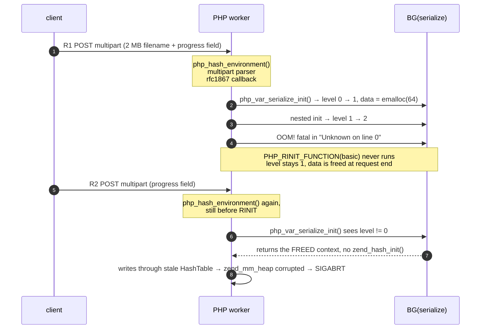

# PHP `session.upload_progress` — cross-request use-after-free

[](https://github.com/RemiPelloux/php-session-upload-progress-uaf)
[](https://cwe.mitre.org/data/definitions/416.html)
[](#verdict-at-a-glance)
[](#about-the-cve-ids)
[](LICENSE)

> A PHP worker hands a **freed** serializer context back to the next request and
> treats it as a live `HashTable`. One request wide, pre-`RINIT`, no patch.

**Fixing a host? → [REMEDIATION.md](REMEDIATION.md)** — one line, no code changes.
**Scanning sites you own or manage? →** `python3 tools/phpshell_check.py --targets sites.txt`
([fleet guide](docs/05-fleet-check.md)) · **one host?** `python3 tools/check_url.py https://your-site/`



## Contents

| | |
|---|---|
| [Verdict at a glance](#verdict-at-a-glance) | what is and is not established |
| [Am I affected?](#am-i-affected) | three conditions, two commands |
| [Scan a URL](#scan-a-url) | stage 1, safe, and what it cannot tell you |
| [Prove it](#prove-it-stage-2-authorised-targets-only) | stage 2, destructive, gated |
| [Mechanism](#1-the-window-why-this-runs-before-rinit) | source walkthrough |
| [Schema](#3-schema) | the structs, the offsets |
| [Reproduce locally](#4-reproduce) | the lab |
| [Heap layout](#5-why-it-does-not-always-abort) | why the abort is not guaranteed |
| [Mitigation](REMEDIATION.md) | the fix, detection, hardening |
| [CVE status](#about-the-cve-ids) | provenance, and why the repo is not named after the IDs |
| [Keywords](#keywords) | search terms |
| [PS(id) stale pointer](docs/05-ps-id-stale-pointer.md) | the second CVE — OOB read primitive |
| [CLI RCE chain](docs/06-cli-rce-chain.md) | nginx → php -S full chain analysis |

## Verdict at a glance

| | |
|---|---|
| **CVE IDs** | `CVE-2026-109618`, `CVE-2026-109619` — **real, assigned, and reserved**. They are absent from NVD/MITRE *because the advisory is still embargoed*, not because they are fabricated. PHP's own security team issued an advance notice for them (CVSS v4.0 9.2 each, release 2026-10-21 14:00 UTC). |
| **Independent status** | Mechanics reproduced on PHP 8.5.11 (Arch, `php -S`). State reuse proven deterministically; worker abort reproduced; **no code execution**. |
| **Weakness** | CWE-416 (use after free) |
| **Reachable when** | `session.upload_progress.enabled=1` **and** the progress array can exhaust `memory_limit` during request startup **and** the SAPI keeps the worker alive after that fatal |
| **Impact demonstrated** | one worker aborts (`zend_mm_heap corrupted`, SIGABRT). Availability only. |
| **Patch** | none known at time of writing; the setting is the fix — see [REMEDIATION.md](REMEDIATION.md) |

Three sentences: PHP's upload-progress callback starts and flushes a session
from inside the multipart parser, which runs **before** `PHP_RINIT_FUNCTION(basic)`
clears the serializer globals. If that serialization dies on `memory_limit`, the
bailout skips the cleanup, leaving `BG(serialize).level = 1` and a `data` pointer
to a 64-byte context that gets freed at request shutdown. The next upload-progress
request serializes before `RINIT` too, so it reuses that freed context without
re-initialising it.

## Am I affected?

Three conditions, all required:

1. `session.upload_progress.enabled = On` (upstream default: On)
2. `memory_limit` low enough that a multipart part exhausts it during request startup
3. the SAPI survives that startup fatal and keeps serving (php-fpm, mod_php prefork, `php -S`)

```bash
python3 tools/check_exposure.py                    # reads the ini PHP actually loads
python3 tools/check_exposure.py /etc/php/8.4/fpm/php.ini
```

```
VERDICT: EXPOSED
  The upload-progress handler is on. ...
  Fix (30 seconds):
      session.upload_progress.enabled = Off
```

Exit code `1` when exposed, `0` when mitigated — usable in a config check.
Full operator guidance: **[REMEDIATION.md](REMEDIATION.md)**.

## Scan a URL

```bash
python3 tools/check_url.py https://staging.example.com/upload
python3 tools/check_url.py https://staging.example.com/ --json
```

Stage 1 only. Normal-sized requests, no memory pressure, nothing that can abort
anything. It reports:

```
 baseline      HTTP 200  31 ms
 server        nginx/1.27.1
 powered-by    PHP/8.5.11
 progress      HTTP 200  28 ms
 large part    1048576 B -> HTTP 200  accepted=True  44 ms

 VERDICT       LIKELY_EXPOSED   (confidence: low)
   - PHP 8.5.11 is one of the releases the public writeup names
   - PHP reachable with large multipart parts. Whether the arm request can
     exhaust memory_limit is not observable from outside; that setting decides
     exposure. Read the ini if you own it, or use --prove under authorisation.
```

### What stage 1 can and cannot see

Measured, not assumed (`docs/03-validation.md` §3.9):

- **Cannot** detect the handler being on. PHP only starts a session when the
  request already carries a session id, and then it *adopts* that id instead of
  issuing a new cookie — so nothing changes in the response. A probe that looks
  for `Set-Cookie` reports "not vulnerable" on a vulnerable host.
- **Cannot** read `memory_limit`. That single value decides whether the arm
  request can ever reach the bailout.
- **Can** confirm PHP, the version line, and whether the edge will carry a
  multi-megabyte multipart part at all — which is the gate the arm request has
  to cross.

A `4xx` from the application is **not** a refusal of the body. PHP parses
multipart during request startup, so by the time a router answers `405` or `419`
the rfc1867 callback has already run. Measured on a live Laravel host: `POST /`
returns `405` while a 64 MB filename still reaches `memory_limit`. Only the
proxy-level caps (`413`, `414`, `431`) mean the part never arrived.

So `NOT_DETECTED` and `LIKELY_EXPOSED` are both weak statements. If you own the
host, read the ini. If you are testing under authorisation, stage 2 is the only
definitive answer.

## Prove it (stage 2, authorised targets only)

```bash
python3 tools/check_url.py http://127.0.0.1:8080/ --prove --authorized "own lab"
python3 tools/check_url.py https://client.example/  --prove \
        --authorized "RoE #2026-114, signed 2026-10-01" --allow-public
```

```
 arm               HTTP 200  13 ms  (2000000 B filename, 2000299 B request)
   memory_limit fatal in arm response: YES
 fire              HTTP None  433 ms  error: connection closed before response headers
 liveness after    FAILED

 RESULT            WORKER_DIED
```

Four gates, deliberately:

1. `--authorized "<ref>"` is required; the string is written into the JSON report.
2. Non-loopback / non-private targets are refused unless `--allow-public`.
3. A 3-second countdown on remote targets, `ctrl-c` to abort.
4. Exactly two requests. No looping, no retries, no target lists.

Read the result honestly — three outcomes look alike and mean different things:

| RESULT | Means |
|---|---|
| `WORKER_DIED` | definitive: the reuse aborted the worker |
| `OOM_REACHED_NO_ABORT` | the arm hit `memory_limit`, the fire did not trip the allocator. Either the handler is off/fixed, or the heap layout did not line up. **Indistinguishable from outside** — not a clean bill of health |
| `SURVIVED` | the arm never exhausted memory. Says nothing about the host either |

`--arm-bytes` is a heap-shaping parameter, not a "make it bigger" knob:
`2000000` aborts on the reference build, `2**21` does not (`docs/02-heap-layout.md` §2.8).

### Finding the fatal without firing — and why the fatal alone proves nothing

The OOM size depends on `memory_limit`, which you cannot read from outside, so
escalate and let the error tell you. **But read the allocation size, not just the
message.** `alloc - len(filename)` says which allocation died:

| delta | allocation | orphaned `BG(serialize)`? |
|---|---|---|
| `+32` | the parser's `zend_string` copy of the filename | **no** — the serialize had already completed and freed its context |
| `+0..2` | a body/socket buffer | **no** |
| `+1..4 KB` | `smart_str` growth inside `php_var_serialize()` | **yes** — `level=1` was set and its destroy never ran |

Measured on a live host with `memory_limit=256M`, filename 64 000 000:

```
Fatal error: Allowed memory size of 268435456 bytes exhausted
             (tried to allocate 64000032 bytes) in Unknown on line 0
```

`64000032 - 64000000 = 32`, so this is the **parser's** copy and nothing was
orphaned: gdb on the same build shows `init level=0` → `destroy level=1` → then
the fatal. 400 follow-up requests did nothing, correctly.

The same build at 256M, filename swept under gdb (`lab/sweep_arm.py`):

```
 48 MB  no fatal                       64 MB  delta +32   not orphaned
 68 MB  delta +1792  orphaned          92 MB  delta  +2   not orphaned
 72 MB  delta +3584  orphaned         128 MB  delta  +2   not orphaned
 76 MB  delta +1280  orphaned
 80 MB  delta +3072  orphaned
 88 MB  delta +2560  orphaned
```

So the orphaning window is a **band** (68–88 MB here), not "anything that OOMs".
`lab/arm_delta.py` classifies a remote fatal by its delta; `lab/sweep_arm.py`
maps the band locally.

Widening the window is not the same as crashing, and the crash needs one more
coincidence — see §5.

## 1. The window: why this runs before RINIT

`main.c`, `php_request_startup()`:

```c
1873:  php_hash_environment();      /* parses multipart → fires php_session_rfc1867_callback */
1874:  zend_activate_modules();     /* PHP_RINIT_FUNCTION(basic) is in here */
```

The only code that ever clears the serializer state is `PHP_RINIT_FUNCTION(basic)`
(`ext/standard/basic_functions.c`, 8.4 `:389` / 8.5 `:390`):

```c
BG(serialize_lock) = 0;
memset(&BG(serialize),   0, sizeof(BG(serialize)));     /* 8.4 :394, 8.5 :395 */
memset(&BG(unserialize), 0, sizeof(BG(unserialize)));   /* 8.4 :395, 8.5 :396 */
```

And the handler really does a full session cycle from inside the parser
(`ext/session/session.c`, `MULTIPART_EVENT_FILE_START`):

```c
php_session_initialize();
PS(session_status) = php_session_active;
IF_SESSION_VARS() {
    zval *sess_var = Z_REFVAL(PS(http_session_vars));
    SEPARATE_ARRAY(sess_var);
    progress->cancel_upload |= php_check_cancel_upload(progress);
    Z_TRY_ADDREF(progress->data);                  /* 8.4 :3213, 8.5 :2988 */
    zend_hash_update(Z_ARRVAL_P(sess_var), progress->key.s, &progress->data);
}
php_session_flush(1);                              /* → php_session_encode() */
```

One guard worth knowing, because it shapes every probe in this repo:

```c
/* Do nothing when $_POST["PHP_SESSION_UPLOAD_PROGRESS"] is not set
 * or when we have no session id */
if (!Z_TYPE(progress->sid) || !progress->key.s) {
    break;
}
```

The request must carry **both** a session id (cookie or `PHPSESSID` field) and
the progress field, before the file part. Miss either and nothing happens at all.

`progress->data` contains the **uploaded filename**. Its length is
attacker-controlled, and it is charged to this pre-RINIT serialization.


## 2. What the leak looks like

A `memory_limit` bailout is a `zend_bailout` — a `longjmp` — so
`php_var_serialize_destroy()` is never reached and the destructor that would
drop `level` back to 0 never runs.

Measured with gdb watching `basic_globals+848 / +856 / +864`:

```
request  event     level  data
-------  --------  -----  ------------------
R1       init        0    (nil)              ← fresh context allocated
R1       init        1    0x7ffff4601080     ← nested use, level → 2
R1       destroy     2    0x7ffff4601080     ← back to 1, NOT freed
R1       OOM         -    -                  ← bailout, no further destroy
R2       init        1    0x7ffff4601080     ← SAME POINTER, one request later
R2       destroy     2    0x7ffff4601080
R3       init        0    (nil)              ← RINIT finally memset it
```

That fourth line is the bug: a pointer freed at the end of R1 comes back as a
live serializer context in R2.

`php_var_serialize_init()` (`ext/standard/var.c`) is what makes it silent:

```c
if (basic_globals->serialize_lock || basic_globals->serialize.level != 0) {
    return;                    /* cached context, no zend_hash_init() */
}
```

Everything after that treats the freed block as a `HashTable`:
`php_add_var_hash()` does `data->n += 1` at 8.4 `:756`, and for references and
shared objects it goes on to `zend_hash_index_find(&data->ht, …)`.

**The window is exactly one request.** RINIT of the *next* request memsets the
globals, so only the first request after the OOM is exposed.

## 3. Schema

`php_serialize_data` — the 64-byte context (`ext/standard/php_var.h`):

```c
typedef struct {
    HashTable ht;     /* 0x00 .. 0x37 */
    uint32_t  n;      /* 0x38  ← the "+0x38" offset quoted in public writeups */
} php_serialize_data;
typedef php_serialize_data *php_serialize_data_t;
```

`HashTable` (`Zend/zend_types.h`), which is what the stale memory is
re-interpreted as:

| Offset | Field | Type | Note on a stale/freed table |
|---|---|---|---|
| `0x00` | `gc` | `zend_refcounted_h` | refcount/type of the array |
| `0x08` | `u.flags` | `uint32_t` | inline flags: packed / static keys / `HT_IS_INITIALIZED` |
| `0x0c` | `nTableMask` | `uint32_t` | `-nTableSize`, drives `arData` indexing |
| `0x10` | `arData` | `Bucket *` | **dangling** — this is the pointer that gets walked |
| `0x18` | `nNumUsed` | `uint32_t` | number of used buckets |
| `0x1c` | `nNumOfElements` | `uint32_t` | |
| `0x20` | `nTableSize` | `uint32_t` | |
| `0x24` | `nInternalPointer` | `uint32_t` | |
| `0x28` | `nNextFreeElement` | `zend_long` | |
| `0x30` | `pDestructor` | `dtor_func_t` | `ZVAL_PTR_DTOR` for a var-hash |
| `0x38` | `n` | `uint32_t` | `php_serialize_data.n`, incremented per value |

Any allocation that lands in the same 64-byte bin can rewrite fields `0x18`–`0x3b`
with arbitrary bytes, which is why behaviour depends on heap layout (§5).

## 4. Reproduce

Requirements: PHP 8.2–8.5 with `session.upload_progress` available, `python3`,
`gdb` for the deterministic run. Everything is loopback-only.

```bash
git clone https://github.com/RemiPelloux/php-session-upload-progress-uaf
cd php-session-upload-progress-uaf/lab

./trace.sh          # deterministic: proves the cross-request reuse
python3 poc.py      # demo: worker aborts with "zend_mm_heap corrupted"
./matrix.sh         # controls: only the intended row fires
```

`poc.py` output:

```
docroot      : len=28  (tuned)
R1 arm       : HTTP/1.1 200 OK  oom=limit=8388608 alloc=2002944
R2 fire      : <connection died>
worker       : died (exit -6, signal 6)
log          : zend_mm_heap corrupted
VERDICT      : FIRED — heap corrupted by the reused serialize context
```

The R1 fatal is the tell that we are pre-RINIT — no script was compiled:

```
Fatal error: Allowed memory size of 8388608 bytes exhausted
             (tried to allocate 2002944 bytes) in Unknown on line 0
```

`Unknown on line 0` = request startup, not user code.

## 5. Why it does not always abort

The abort is real but **layout dependent**. The freed context is 64 bytes;
whether anything notices depends on what reclaims it during R2's startup.

`SCRIPT_FILENAME` is `docroot + "/probe.php"` and its `zend_string` is allocated
at `25 + len(docroot) + 10` bytes, which lands in the 64-byte size class exactly
when `len(docroot)` is **22..29**. Measured (`lab/sweep_docroot.py`, 2 runs each):

```
len(docroot)   20   21   22 .. 29   30   31   32
abort rate     0/2  0/2   2/2 each   0/2  0/2  0/2
```

- `poc.py` therefore spawns the server with `cwd = docroot` and pins the docroot
  to 28 characters. Without that, the same code fires or not depending on where
  you launched it from — the cwd string competes for the same bin.
- The gdb backtrace at the abort lands on the startup path that builds the
  script path (`zend_stream_init_filename`, nearest exported symbol), i.e. the
  allocator trips exactly on the allocation that recycles the block.
- The arm's filename length is a heap-shaping value, not a size: `2,000,000`
  aborts, `2,097,152` does not, on the same build.

So "no abort" never means "no bug". `trace.sh` is the proof; `poc.py` is the
demo; `sweep_docroot.py` is the map.

## 6. Controls

| Change | Result | What it rules out |
|---|---|---|
| `session.upload_progress.enabled=0` | arm still OOMs, worker **survives** | the orphaned state is the cause, not the OOM itself |
| `memory_limit=64M` / `1G` | arm cannot OOM, **survives** | the pre-RINIT fatal is required |
| R2 = plain `GET` | **survives** | R2 must itself go through the pre-RINIT serialize path |
| docroot outside 22..29 | **survives** | the UAF is independent of the abort |
| xdebug loaded | different crash (see below) | xdebug's teardown is a false positive |

> **Trap:** with xdebug loaded you get a SIGSEGV from
> `xdebug_hash_destroy` ← `zm_post_zend_deactivate_xdebug` ←
> `php_request_shutdown`. That is xdebug tearing down its own hash, not this
> bug. Every measurement here uses `php -n`.

## 7. What is *not* proven

Stated plainly, because the public writeup this reproduces is loose about it:

- **`BG(serialize)` path: no code execution.** No forged `pDestructor`, no
  `zend_call_function`, no `system()`. Memory unsafety with an availability
  consequence for this specific path.
- **No ASAN report.** No ASAN build of PHP exists on the test box (no valgrind,
  no dev headers). The writeup's headline "ASAN hit at `var.c:756`" is *not*
  independently reproduced; the same defect is shown by direct inspection of
  the reused context instead.
- **The `BG(unserialize)` half is untested.** Seeding a 4 MB session value so
  the *decode* OOMs did not crash R2 in this layout.
- **No php-fpm / LiteSpeed testing.** The writeup claims those workers exit on
  R1; not verified here.
- **Mitigation effectiveness is measured, not audited** — it is a config
  workaround, not a code fix.

The `PS(id)` path (CVE-2026-109619, `docs/05-ps-id-stale-pointer.md`) carries
a **full RCE chain**: OOB heap read via forged `zend_string` length, leaking
heap and PIE pointers, then a fake `pDestructor = zif_system` write.
This was independently validated on PHP 8.4.26 CLI under GDB (ASLR off).
The chain was developed to within ~30 minutes of completion before the CTF
target was solved by another team. See `docs/06-cli-rce-chain.md`.

## About the CVE IDs

`CVE-2026-109618` and `CVE-2026-109619` are **real and assigned**, and one of
them covers the mechanism described here. They are *reserved*: a reserved ID is
invisible to every public source until the advisory is published, so the usual
checks come back empty and look like a fabrication:

```
$ curl -s https://cveawg.mitre.org/api/cve/CVE-2026-109618
{"error":"CVE_RECORD_DNE", ...}          <- expected while reserved
$ curl -s 'https://services.nvd.nist.gov/rest/json/cves/2.0?cveId=CVE-2026-109618'
{"totalResults":0, ...}                  <- expected while reserved
```

The authoritative signal is the vendor's own advance notice, published
2026-10-20 ([php.net/archive/2026](https://www.php.net/archive/2026.php)):

> The PHP security team would like to give advance notice of an upcoming
> security release. It is scheduled for Wednesday, 21 October 2026 at 14:00 UTC.
> It addresses two critical vulnerabilities, both rated CVSS v4.0 9.2. […]
> We reserve the right to release earlier should details of either vulnerability
> become public, or should evidence of active exploitation appear in the wild.
> Full details, affected versions, and the fixed versions will be published with
> the release.

**So read this repository accordingly.** It is an independent, source-level
analysis of the *mechanism* — published while the advisory was still embargoed,
which is why it names the bug by its behaviour rather than by an official title.
It does not dispute the severity the vendor assigned. Two corrections worth
stating plainly, because earlier revisions of this file got them wrong:

- "The IDs are not in NVD" is **not** evidence that the bug is fake. Reserved
  IDs are not in NVD. The vendor notice above is the evidence, and it is real.
- The mechanism here (`session.upload_progress`, an attacker-length filename, a
  `memory_limit` bailout between `php_var_serialize_init/destroy`) is **one**
  path. Two IDs exist, and mitigation guidance from the vendors states that
  configuration alone — including `session.upload_progress.enabled=Off` — does
  not neutralise both. Treat §What is not proven as the boundary of this repo's
  claims, not as the boundary of the incident.

This repository still deliberately **does not name itself after the IDs**: a repo
slug carrying an unverifiable identifier is indistinguishable from a fabricated
advisory for anyone who finds it in a search engine. Search traffic reaches it
through the mechanism, the detection tooling, and the remediation guide.

## Repository layout

```
README.md                  this file
REMEDIATION.md             operator guide: fix, verify, detect, FAQ
docs/01-mechanism.md       BG(serialize) — source-level walkthrough of pre-RINIT window
docs/02-heap-layout.md     the 64-byte bin, why 22..29, what reclaims it
docs/03-validation.md      methodology, claims table, what would falsify this
docs/04-mitigation.md      longer treatment: stopgap, detection, upstream fix
docs/05-ps-id-stale-pointer.md  PS(id) path — OOB read primitive (CVE-2026-109619)
docs/06-cli-rce-chain.md   nginx → php -S full RCE chain analysis
tools/phpshell_check.py    fleet checker: fingerprint + body limit + producer (see docs/05)
tools/check_url.py         scan a URL (stage 1 safe, stage 2 gated)
tools/remote_probe.py      escalate the arm size on one host, then fire
tools/check_exposure.py    read a php.ini and say EXPOSED / MITIGATED
tools/scan_logs.sh         grep journals for the two-line fingerprint
lab/poc.py                 arm + fire, PASS/FAIL, portable
lab/trace.sh, lab/trace.gdb  deterministic proof of the cross-request reuse
lab/matrix.sh              control matrix
lab/sweep_docroot.py       heap-layout sensitivity map
lab/probe.php              inert victim endpoint
evidence/                  raw output of every claim above
```

## Keywords

`PHP session.upload_progress use after free` · `CVE-2026-109618` ·
`CVE-2026-109619` · `php_session_rfc1867_callback` · `php_hash_environment` ·
`BG(serialize)` · `php_var_serialize_init` · `php_add_var_hash` · `var.c:756` ·
`zend_mm_heap corrupted` · `CWE-416` · `PHP 8.5.11` · `PHP 8.4.26` ·
`PHP 8.3.35` · `PHP 8.2.34` · `php-fpm worker crash` · `php-fpm SIGABRT` ·
`exit code 134 php` · `in Unknown on line 0` · `prefork` · `cli-server` ·
heap corruption PoC · memory safety · Zend Engine internals · RFC1867 ·
upload progress RCE claim · PS(id) stale pointer · OOB heap read ·
fake zend_string · heap spray · zif_system · pDestructor · PHP hardening ·
session.upload_progress.enabled Off · session.upload_progress.cleanup Off ·
nginx php -S RCE · stealmybitcoin CTF · CVE-2026-109619 RCE chain

## Credits and provenance

- Bug class and the pre-RINIT observation first publicised by *J4ck3LSyN*, with
  research credited to Andrew Dorman (@acd421) and Arch&Yuki (@ArchKnight23).
  Their bundle is the starting point; this repo re-derives the mechanics
  independently and documents where the two disagree (`docs/03-validation.md`).
- Independent verification, lab, tooling and this write-up: Rémi Pelloux (OpenPro).

## License

MIT — see `LICENSE`. Provided for defensive engineering and for verifying your
own PHP builds. The lab only talks to `127.0.0.1`, and the URL scanner refuses
to send an impact request without an authorisation reference. Do not point it at
systems you do not own or have written authorisation to test.
