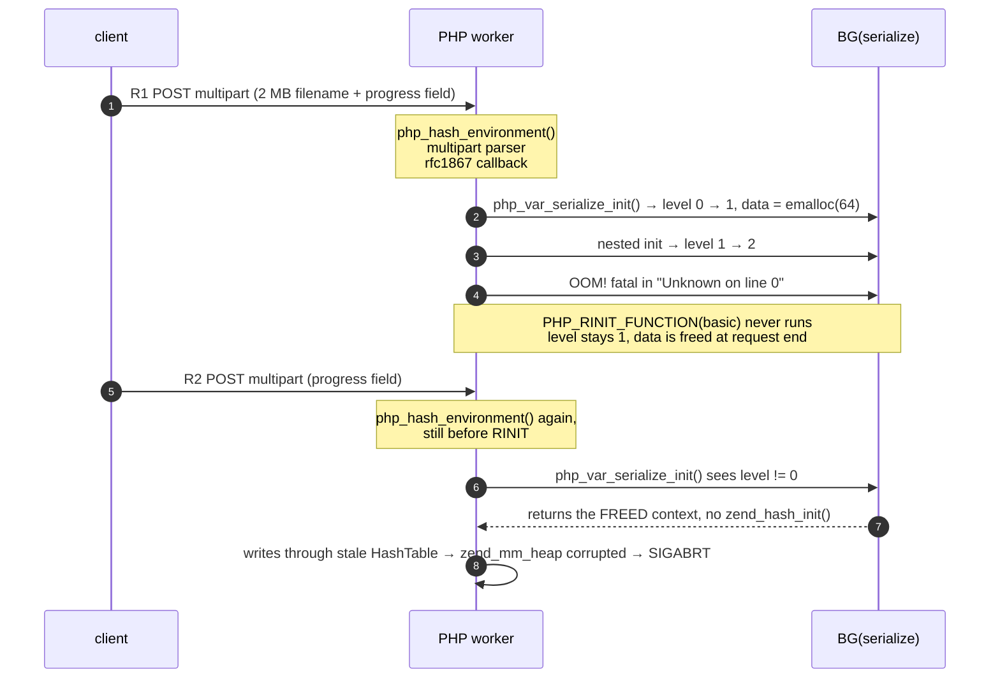

# PHP `session.upload_progress` — cross-request use-after-free

> A PHP worker hands a **freed** serializer context back to the next request and
> treats it as a live `HashTable`. One request wide, pre-`RINIT`, no patch.



| | |
|---|---|
| **Claimed IDs** | `CVE-2026-109618`, `CVE-2026-109619` — **not registered**. MITRE returns `CVE_RECORD_DNE`, NVD returns `totalResults: 0` (checked 2026-10-21). Treat those IDs as an unverified claim, not as an advisory. |
| **Independent status** | Mechanics reproduced on PHP 8.5.11 (Arch, `php -S`). State reuse proven deterministically; worker abort reproduced; **no code execution**. |
| **Weakness** | CWE-416 (use after free), CWE-667 adjacent (improper locking/state ownership) |
| **Reachable when** | `session.upload_progress.enabled=1` **and** the progress array can exhaust `memory_limit` during serialization **and** the SAPI worker survives a request-startup bailout |
| **Patch** | none known at time of writing; stopgap below |

Three sentences: PHP's upload-progress callback starts and flushes a session
from inside the multipart parser, which runs **before** `PHP_RINIT_FUNCTION(basic)`
clears the serializer globals. If that serialization dies on `memory_limit`, the
bailout skips the cleanup, leaving `BG(serialize).level = 1` and a `data`
pointer to a 64-byte context that gets freed at request shutdown. The next
upload-progress request serializes before `RINIT` too, so it reuses that freed
context without re-initialising it.

---

## 1. The window: why this runs before RINIT

`main.c`, `php_request_startup()`:

```c
1873:  php_hash_environment();      /* parses multipart → fires php_session_rfc1867_callback */
1874:  zend_activate_modules();     /* PHP_RINIT_FUNCTION(basic) is in here */
```

The only code that ever clears the serializer state is `PHP_RINIT_FUNCTION(basic)`
(`ext/standard/basic_functions.c`, 8.4 `:389` / 8.5 `:390`):

```c
BG(serialize_lock) = 0;
memset(&BG(serialize),   0, sizeof(BG(serialize)));     /* 8.4 :394, 8.5 :395 */
memset(&BG(unserialize), 0, sizeof(BG(unserialize)));   /* 8.4 :395, 8.5 :396 */
```

And the handler really does a full session cycle from inside the parser
(`ext/session/session.c`, `MULTIPART_EVENT_FILE_START`):

```c
php_session_initialize();
PS(session_status) = php_session_active;
IF_SESSION_VARS() {
    zval *sess_var = Z_REFVAL(PS(http_session_vars));
    SEPARATE_ARRAY(sess_var);
    progress->cancel_upload |= php_check_cancel_upload(progress);
    Z_TRY_ADDREF(progress->data);                  /* 8.4 :3213, 8.5 :2988 */
    zend_hash_update(Z_ARRVAL_P(sess_var), progress->key.s, &progress->data);
}
php_session_flush(1);                              /* → php_session_encode() */
```

`progress->data` contains the **uploaded filename**. Its length is fully
attacker-controlled, and it is charged to this pre-RINIT serialization.


## 2. What the leak looks like

`BG(serialize)` is a `php_serialize_data` (see the schema below). A `memory_limit`
bailout is a `zend_bailout` — a `longjmp` — so `php_var_serialize_destroy()` is
never reached and the destructor that would drop `level` back to 0 never runs.

Measured with gdb watching `basic_globals+848 / +856 / +864`:

```
request  event     level  data
-------  --------  -----  ------------------
R1       init        0    (nil)              ← fresh context allocated
R1       init        1    0x7ffff4601080     ← nested use, level → 2
R1       destroy     2    0x7ffff4601080     ← back to 1, NOT freed
R1       OOM         -    -                  ← bailout, no further destroy
R2       init        1    0x7ffff4601080     ← SAME POINTER, one request later
R2       destroy     2    0x7ffff4601080
R3       init        0    (nil)              ← RINIT finally memset it
```

That fourth line is the bug: a pointer freed at the end of R1 comes back as a
live serializer context in R2.

`php_var_serialize_init()` (`ext/standard/var.c`) is what makes it silent:

```c
if (basic_globals->serialize_lock || basic_globals->serialize.level != 0) {
    return;                    /* cached context, no zend_hash_init() */
}
```

Everything after that treats the freed block as a `HashTable`:
`php_add_var_hash()` does `data->n += 1` at 8.4 `:756`, and for references and
shared objects it goes on to `zend_hash_index_find(&data->ht, …)`.

**The window is exactly one request.** RINIT of the *next* request memsets the
globals, so only the first request after the OOM is exposed.

## 3. Schema

`php_serialize_data` — the 64-byte context (`ext/standard/php_var.h`):

```c
typedef struct {
    HashTable ht;     /* 0x00 .. 0x37 */
    uint32_t  n;      /* 0x38  ← the "+0x38" offset quoted in public writeups */
} php_serialize_data;
typedef php_serialize_data *php_serialize_data_t;
```

`HashTable` (`Zend/zend_types.h`), which is what the stale memory is
re-interpreted as:

| Offset | Field | Type | Note on a stale/freed table |
|---|---|---|---|
| `0x00` | `gc` | `zend_refcounted_h` | refcount/type of the array |
| `0x08` | `u.flags` | `uint32_t` | inline flags: packed / static keys / `HT_IS_INITIALIZED` |
| `0x0c` | `nTableMask` | `uint32_t` | `-nTableSize`, drives `arData` indexing |
| `0x10` | `arData` | `Bucket *` | **dangling** — this is the pointer that gets walked |
| `0x18` | `nNumUsed` | `uint32_t` | number of used buckets |
| `0x1c` | `nNumOfElements` | `uint32_t` | |
| `0x20` | `nTableSize` | `uint32_t` | |
| `0x24` | `nInternalPointer` | `uint32_t` | |
| `0x28` | `nNextFreeElement` | `zend_long` | |
| `0x30` | `pDestructor` | `dtor_func_t` | `ZVAL_PTR_DTOR` for a var-hash |
| `0x38` | `n` | `uint32_t` | `php_serialize_data.n`, incremented per value |

Any allocation that lands in the same 64-byte bin can rewrite fields `0x18`–`0x3b`
with arbitrary bytes, which is why behaviour depends on heap layout (§5).

## 4. Reproduce

Requirements: PHP 8.2–8.5 with `session.upload_progress` available, `python3`,
`gdb` for the deterministic run. Everything is loopback-only.

```bash
git clone https://github.com/RemiPelloux/php-session-upload-progress-uaf
cd php-session-upload-progress-uaf/lab

./trace.sh          # deterministic: proves the cross-request reuse
python3 poc.py      # demo: worker aborts with "zend_mm_heap corrupted"
./matrix.sh         # controls: only the intended row fires
```

`poc.py` output:

```
docroot      : len=28  (tuned)
R1 arm       : HTTP/1.1 200 OK  oom=limit=8388608 alloc=2002944
R2 fire      : <connection died>
worker       : died (exit -6, signal 6)
log          : zend_mm_heap corrupted
VERDICT      : FIRED — heap corrupted by the reused serialize context
```

The R1 fatal is the tell that we are pre-RINIT — no script was compiled:

```
Fatal error: Allowed memory size of 8388608 bytes exhausted
             (tried to allocate 2002944 bytes) in Unknown on line 0
```

`Unknown on line 0` = request startup, not user code.

## 5. Why it does not always abort (heap layout)

The abort is real but **layout dependent**. The freed context is 64 bytes;
whether anything notices depends on what reclaims it during R2's startup.

`SCRIPT_FILENAME` is `docroot + "/probe.php"` and its `zend_string` is allocated
at `25 + len(docroot) + 10` bytes, which lands in the 64-byte size class exactly
when `len(docroot)` is **22..29**. Measured (`lab/sweep_docroot.py`, 2 runs each):

```
len(docroot)   20   21   22 .. 29   30   31   32
abort rate     0/2  0/2   2/2 each   0/2  0/2  0/2
```

Two more facts from the field:

- `poc.py` therefore **spawns the server with `cwd = docroot`** and pins the
  docroot to 28 characters. Without that, the same code fires or not depending
  on where you launched it from — the cwd string competes for the same bin.
- The gdb backtrace at the abort lands on the startup path that builds the
  script path (`zend_stream_init_filename`, nearest exported symbol), i.e. the
  allocator trips exactly on the allocation that recycles the block.
  See `evidence/abort-backtrace.txt`.

So "no abort" never means "no bug". `trace.sh` is the proof; `poc.py` is the
demo; `sweep_docroot.py` is the map.

## 6. Controls

| Change | Result | What it rules out |
|---|---|---|
| `session.upload_progress.enabled=0` | arm still OOMs, worker **survives** | the orphaned state is the cause, not the OOM itself |
| `memory_limit=64M` / `1G` | arm cannot OOM, **survives** | the pre-RINIT fatal is required |
| R2 = plain `GET` | **survives** | R2 must itself go through the pre-RINIT serialize path |
| docroot outside 22..29 | **survives** | the UAF is independent of the abort |
| xdebug loaded | different crash (see below) | xdebug's teardown is a false positive |

> **Trap:** with xdebug loaded you get a SIGSEGV from
> `xdebug_hash_destroy` ← `zm_post_zend_deactivate_xdebug` ←
> `php_request_shutdown`. That is xdebug tearing down its own hash, not this
> bug. Every measurement here uses `php -n`.

## 7. What is *not* proven

Stated plainly, because the public writeup this reproduces is loose about it:

- **No code execution.** No forged `pDestructor`, no `zend_call_function`, no
  `system()`. This is memory unsafety with an availability consequence.
- **No ASAN report.** No ASAN build of PHP exists on the test box (no valgrind,
  no dev headers). The writeup's headline "ASAN hit at `var.c:756`" is *not*
  independently reproduced; the same defect is shown by direct inspection of
  the reused context instead.
- **The `BG(unserialize)` half is untested.** Seeding a 4 MB session value so
  the *decode* OOMs did not crash R2 in this layout.
- **No php-fpm / LiteSpeed testing.** The writeup claims those workers exit on
  R1; not verified here.
- **Mitigation effectiveness is measured, not audited** — it is a config
  workaround, not a code fix.

## 8. Mitigation (stopgap)

```ini
; php.ini / .user.ini — closes the path: the callback returns before it can
; start a session (ext/session/session.c, 8.4 :3239)
session.upload_progress.enabled = Off
```

Then reload the SAPI. Additional hardening:

1. **Raise `memory_limit`** above the worst case of the progress array — the
   filename length is attacker-controlled, so the array size is too.
2. **Cap `upload_max_filesize` / `post_max_size`** at the edge so a single
   request cannot build a multi-megabyte progress array.
3. **Detect** the fingerprint in logs: `in Unknown on line 0` followed by
   `zend_mm_heap corrupted` on the same worker.

The deeper fix belongs upstream: either clear the serialize globals on bailout,
or make `php_var_serialize_init()` re-initialise whenever the cached context is
not provably live.

## 9. About the CVE IDs

`CVE-2026-109618` and `CVE-2026-109619` are cited by a public writeup
(`jackalsyn.com/posts/php-up-2026.html`) and by a downloadable bundle whose
sha256 matches the value published there. **Neither ID exists in MITRE's CVE
Services or NVD** as of 2026-10-21:

```
$ curl -s https://cveawg.mitre.org/api/cve/CVE-2026-109618
{"error":"CVE_RECORD_DNE", ...}
$ curl -s 'https://services.nvd.nist.gov/rest/json/cves/2.0?cveId=CVE-2026-109618'
{"totalResults":0, ...}
```

This repository deliberately **does not name itself after those IDs**: an
unregistered identifier in a repo slug is indistinguishable from a fabricated
advisory for anyone who finds it in a search engine. The mechanics below are
what is verified; the ID attribution is not.

## Repository layout

```
README.md                  this file
docs/01-mechanism.md       source-level walkthrough of the pre-RINIT window
docs/02-heap-layout.md     the 64-byte bin, why 22..29, what reclaims it
docs/03-validation.md      methodology, controls, what would falsify this
docs/04-mitigation.md      stopgap, detection, hardening
lab/poc.py                 arm + fire, PASS/FAIL, portable
lab/trace.sh, trace.gdb    deterministic proof of the cross-request reuse
lab/matrix.sh              control matrix
lab/sweep_docroot.py       heap-layout sensitivity map
lab/probe.php              inert victim endpoint
evidence/                  raw output of every claim above
```

## Keywords

`PHP session.upload_progress use after free` · `CVE-2026-109618` ·
`CVE-2026-109619` · `php_session_rfc1867_callback` · `php_hash_environment` ·
`BG(serialize)` · `php_var_serialize_init` · `php_add_var_hash` · `var.c:756` ·
`zend_mm_heap corrupted` · `CWE-416` · `PHP 8.5.11` · `PHP 8.4.26` ·
`PHP 8.3.35` · `PHP 8.2.34` · `prefork` · `cli-server` · heap corruption PoC ·
memory safety · Zend Engine internals · RFC1867 · upload progress RCE claim
(retracted — memory safety only)

## Credits and provenance

- Bug class and the pre-RINIT observation first publicised by *J4ck3LSyN*, with
  research credited to Andrew Dorman (@acd421) and Arch&Yuki (@ArchKnight23).
  Their bundle is the starting point; this repo re-derives the mechanics
  independently and documents where the two disagree (`docs/03-validation.md`).
- Independent verification, lab, and this write-up: Rémi Pelloux (OpenPro).

## License

MIT — see `LICENSE`. Provided for defensive engineering and for verifying your
own PHP builds. Do not point this at systems you do not own or have written
authorisation to test.
